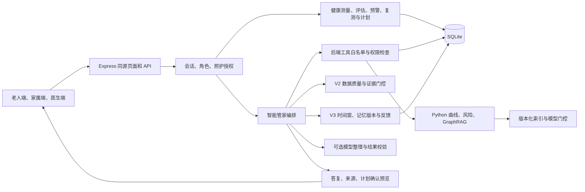

# 结项技术交付索引

审查对象为 2026 年 11 月 17 日的工作目录，基于提交 `575393e`，包含当时尚未提交的 V1、V2、V3 变更。该提交号只标识基线。复现本次审查应使用完整工作目录，交付前应生成代表全部变更的冻结版本。[最终质量审查](../reports/final-project-quality-review-20261117.md) · [测试报告](../reports/final-quality-tests-20261117.md) · [用户手册](user-guide.md)

## 系统架构



前端模板和共享组件从 `frontend/index.html`、`frontend/assets` 提供，移动、协同和桌面采用各自视图，Express 同时托管页面和 API。身份由服务端会话解析。健康数据主体与操作人分别绑定，家属和医生的能力由照护授权范围决定。管理员操作与个人健康授权分别校验。[页面渲染](../server/src/lib/renderPage.js) · [路由入口](../server/src/index.js) · [授权设计](../server/src/contracts/careAccess.js)

管家主入口进入 V3 编排器。常规查询由后端解析目标并计划工具，根据授权裁剪 SQLite 上下文，必要时调用 Python。模型可整理已有证据。V2 研究开关启用质量感知路由，V3 时序开关启用明确历史意图。确认预览与实际写入由独立接口处理。旧的 `agent.js` 通用 `chat()` 仍兼容历史测试，线上主入口通过 `composeGroundedResponse` 调用模型。[编排入口](../server/src/routes/chat.js) · [智能体设计](AGENT_ARCHITECTURE.md) · [工具注册表说明](AGENT_TOOL_REGISTRY.md)

## 本地部署与发布

从仓库根目录运行。Node 22 与 Python 3.14.6 在此次 Windows 环境重新安装并验证，CI 配置另用 Python 3.13。

```powershell
python -m venv .venv
.\.venv\Scripts\python.exe -m pip install -r requirements-test.txt
Set-Location server
npm.cmd ci
$env:HTN_PYTHON = (Resolve-Path ..\.venv\Scripts\python.exe).Path
$env:DB_PATH = Join-Path $env:TEMP ('evicare-review-' + [Guid]::NewGuid() + '.db')
$env:DEMO_SEED = '0'
$env:CORS_ORIGIN = 'http://localhost:3001'
npm.cmd start
```

打开 `http://localhost:3001`，检查 `/api/health`、`/api/health/dependencies` 和登录页。隔离演示可以显式设置 `DEMO_SEED=1`。服务器容器工作目录为 `/app/server`，前后端同容器，持久卷应承载 SQLite 数据。可选模型包按主 README 的流程配置；用生产环境时核对 Redis 登录限速、TLS、Cookie、实际来源白名单和持久卷。当前发布阻断以及 Docker 验收状态以 06 审查为准。[V1 部署与数据库恢复](v1-deployment.md) · [Dockerfile](../Dockerfile) · [CI 配置](../.github/workflows/ci.yml)

| 配置 | 行为 |
| --- | --- |
| `DEMO_SEED`、`DB_PATH` | 隔离演示库与实际用户数据库 |
| `DEEPSEEK_*`、`OPENAI_*`、`LLM_*` | 服务端模型接口与凭据。真实个人数据接入依赖 06 的隐私整改 |
| `AGENT_RESEARCH_V2=1` | 启用可解释质量与证据门控，默认关闭 |
| `AGENT_TEMPORAL_MEMORY_V3=1` | 启用历史时间窗、来源追踪和反馈建议，默认关闭 |
| `HTN_PYTHON`、`PYTHON_SERVICE_URL` | Node 到 Python 的 CLI 或常驻服务 |

## API 索引

[V1 接口和错误码](v1-api.md) 说明测量修订、照护授权、复测和干预草案。以下是管家、知识和隐私入口。写接口使用会话、对象绑定和相应操作权限。

| 接口 | 入口与主要结果 |
| --- | --- |
| `POST /api/auth/register`、`POST /api/auth/login`、`GET /api/auth/me` | 注册、会话、当前身份 |
| `POST /api/chat`、`POST /api/chat/stream`、`GET /api/chat/history` | 管家答复、流式进度和保存的证据。启用研究功能时答复可含 `presentation.research_v2` 或 `presentation.temporal_memory` |
| `GET /api/agent/temporal-memory/:id?subject_user_id=…` | 精确核对来源。当前有效时为 `verified`，原记录改变、替换或档案过期时仅回状态 |
| `GET /api/knowledge/graph/query?q=…` | 返回索引版本、命中证据、引用、关系路径和审核状态 |
| `POST /api/actions/interventions`、`PATCH /api/actions/interventions/:id` | 保存或修改干预草案 |
| `POST /api/actions/interventions/:id/submit`、`POST /api/actions/interventions/:id/confirm` | 提交草案并由本人通过一次性确认凭据激活 |
| `POST /api/actions/interventions/:id/executions` | 保存执行记录、反馈和修订关系 |
| `GET /api/privacy/overview`、`POST /api/privacy/exports` | 隐私概览、本人导出 |
| `POST /api/privacy/deletion-requests` 及其确认接口 | 本人创建和确认删除请求 |
| `POST /api/care/relationships/:id/revoke` | 撤回照护权，后续访问重新校验 |

## 数据库设计索引

SQLite 业务关系与迁移均在 `server/src/db.js`。启动启用外键约束和 WAL 模式，本轮使用临时库校验数据库完整性与关系。备份、恢复和敏感字段口径见 [部署说明](v1-deployment.md) 与 [V1 数据字典](v1-data-dictionary.md)。

| 实体 | 关联与用途 |
| --- | --- |
| `users`、`sessions`、`care_relationships` | 账号、会话和照护授权。会话令牌只保留摘要 |
| `metrics`、`metric_defs`、`devices`、`alerts` | 测量值、单位、来源、条件、质量、修订号和规则证据 |
| `action_requests`、`followups`、`interventions` | 确认凭据、复测候选、计划草案和当前状态 |
| `intervention_execution_logs`、`intervention_evaluations` | 执行反馈、前版关系、评价和证据版本 |
| `agent_conversations`、`chat_messages`、`agent_runs`、`agent_tool_calls` | 对话绑定、保存的呈现、运行状态和工具证据 |
| `agent_memories`、`temporal_memory_revisions` | 已确认偏好与时序记忆版本。时序版本保留来源编号、摘要指纹和替换关系 |
| `audit_logs`、`care_access_logs`、`privacy_deletion_requests` | 操作追踪、照护访问与删除请求状态 |

## 算法及证据

| 组件 | 实现与结果 |
| --- | --- |
| 个人曲线、人口风险 | [Curve 验证](../reports/curve-temporal-validation-20260821.md) · [CHARLS 受试者隔离评估](../reports/national-award-risk-temporal-disjoint-evaluation-20260821.md) · [模型卡](../deliverables/national_award/model_card.md) |
| GraphRAG | [知识检索说明](../elderly-health-rag/README.md) · [索引范围](../elderly-health-rag/output/index_stats.json) · [方法对照](../reports/graphrag-method-comparison-20260826.md) |
| V2 | [质量策略](../server/src/ai/qualityPolicy.js) · [研究协议](../research/v2/PROTOCOL.md) · [对照结果](../research/v2/REPORT.md) |
| V3 | [时序策略](../server/src/ai/temporalPolicy.js) · [时序与反馈实验](../research/v3/REPORT.md) |
| 计划前后描述 | [干预评价设计](../reports/intervention-evaluation-engine-20260828.md) · [合成干跑](../reports/intervention-evaluation-synthetic-dry-run-20260828.md) |

旧交付说明中的家属代录限制早于 V1 权限改版。现行行为为明确授予 `record_measurements` 后可代录。2026 年 8 月的提交包、医生签字表和 PPT 是历史材料。当前结项以本索引、06 结项审查和对应版本的报告为准。[历史交付说明](final-delivery.md) · [现行授权契约](../server/src/contracts/careAccess.js)
